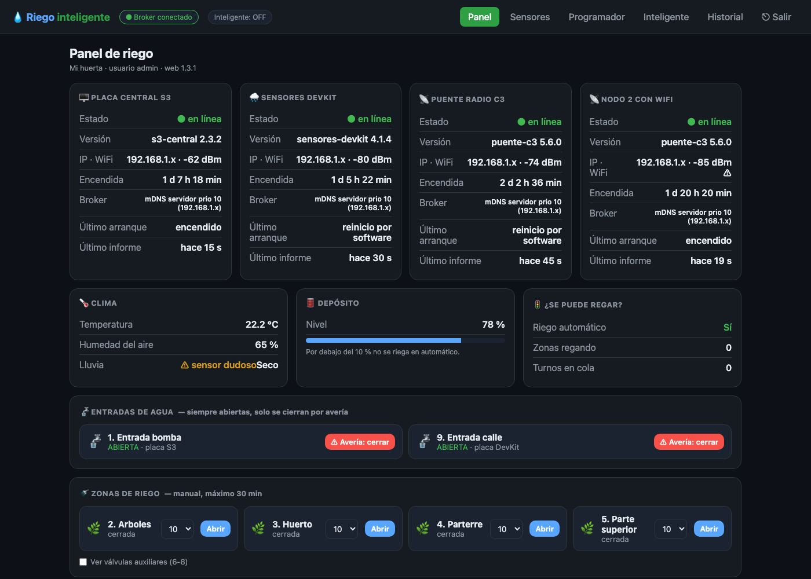

# Riego inteligente con ESP32

[English](README.en.md)

Sistema de riego para casa y huerto con placas ESP32, MQTT y un servidor pequeño (un Mac o Linux). Riega por zonas según la humedad del suelo, la lluvia y la previsión del tiempo, y avisa si algo falla.

## Piezas
| Carpeta | Qué es |
|---|---|
| `firmware/s3-central` | Placa central ESP32-S3 con pantalla táctil (LVGL) y 8 relés de válvulas. Tiene programas, riego manual con tope de 30 min, modo inteligente y OTA. |
| `firmware/sensores-devkit` | ESP32 con sensor de lluvia, nivel del depósito (AJ-SR04M) y la válvula de entrada de la calle. |
| `firmware/puente-c3` | ESP32-C3 que recibe los nodos por ESP-NOW (y 433 MHz de respaldo) y lo pasa a MQTT. También hace la OTA de los nodos. |
| `firmware/nodo-humedad` | Nodos de humedad del suelo con ESP32-C3 SuperMini a batería. Pueden hacer de repetidor ESP-NOW. |
| `gestor/` | Web con usuario y contraseña (FastAPI) para ver y mandar el riego. El «cerebro» ajusta los riegos según el tiempo (Open-Meteo y, opcional, AEMET). |
| `servidor/mosquitto` | Broker Mosquitto con un usuario y permisos (ACL) por placa. |
| `servidor/vigilante` | Reinicia servicios caídos y avisa de placas sin señal o cortes de luz. |
| `servidor/ota-nodos` | Actualiza el firmware de los nodos por ESP-NOW. |
| `servidor/herramientas` | Simulador de nodos para probar sin placas. |

## Empezar
1. **Firmware**, con PlatformIO:
   - En cada placa, copia `include/secretos.example.h` como `include/secretos.h` y pon tu WiFi y tus claves. `secretos.h` no se sube a Git.
   - Cambia `MQTT_FALLBACK_IP` en `src/main.cpp` por la IP de tu servidor (normalmente lo encuentran solas por mDNS).
   - Compila y sube con `pio run -e <entorno> -t upload`. Para OTA, pon la contraseña en la variable `RIEGO_OTA_PASS`.
2. **Broker**:
   - En Mac: `servidor/mosquitto/instalar_mac.sh`.
   - En Linux: instala mosquitto, usa `acl` y crea los usuarios con `crear_usuarios.sh`.
3. **Gestor**:
   - Copia `gestor/config.example.json` como `gestor/config.json`.
   - Instala lo necesario con `pip install -r gestor/backend/requirements.txt`.
   - Crea tu usuario con `crear_usuario_web.py` y arranca con `python web.py`.
4. **Vigilante** (en Mac): `servidor/vigilante/instalar_servicios_mac.sh`. En los `.plist`, cambia `TU_USUARIO` por tu usuario.

## Seguridad
- Cada placa tiene su propio usuario en el broker y solo puede tocar sus temas (`servidor/mosquitto/acl`).
- La web pide usuario y contraseña.
- Las contraseñas de WiFi, MQTT y OTA solo están en `secretos.h` y `config.json`, que nunca van a Git.

## Licencia
**Uso personal y no comercial gratuito** bajo la [PolyForm Noncommercial 1.0.0](LICENSE.md): puedes montarlo en tu casa, estudiarlo y modificarlo. Para venderlo, instalarlo a clientes o usarlo en un negocio hace falta una licencia comercial de pago: escríbeme por [GitHub](https://github.com/Iklavid).
Al limitar el uso comercial, esta licencia no es «open source» según la OSI; el código sigue siendo público.
